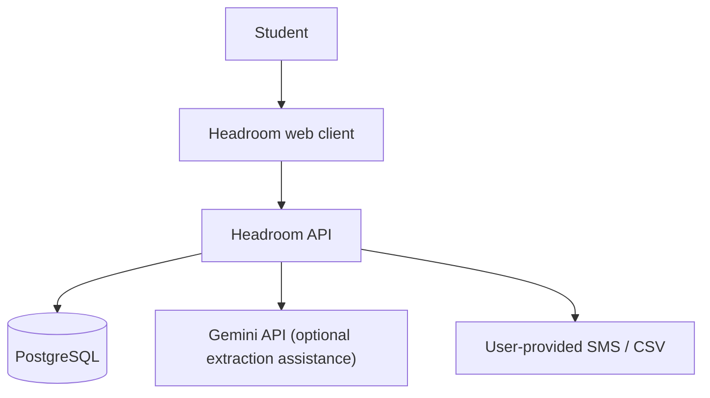
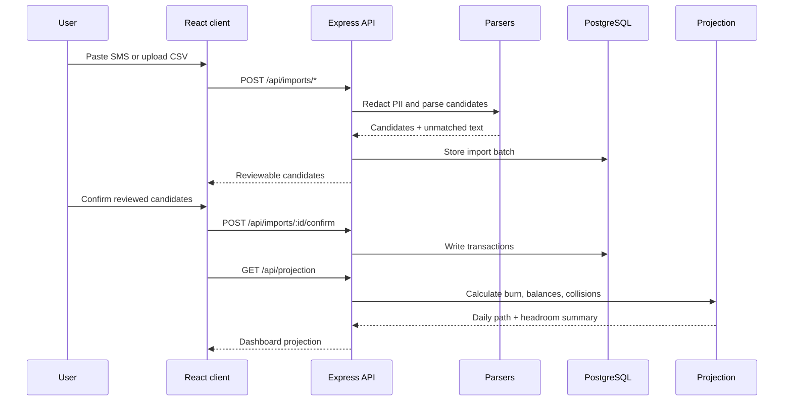
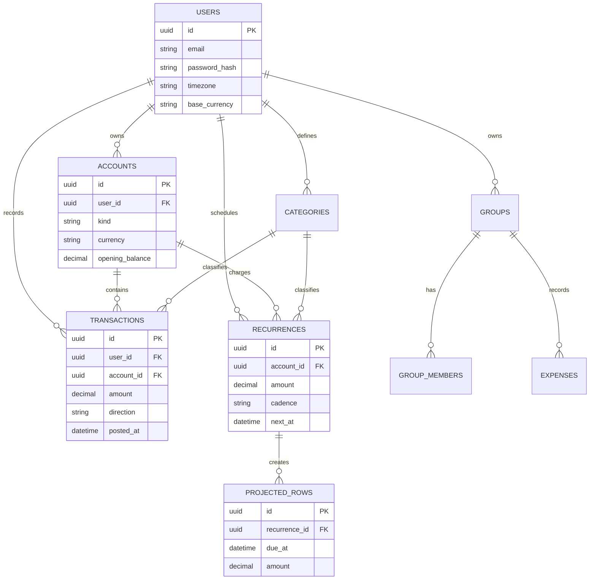

# Architecture

## System context

The browser is the only client in the current repository. Direct bank connections are intentionally out of scope for v1; all imports are initiated by the user.

## Runtime request flow

## Workspace boundaries

| Workspace | Responsibility |
|---|---|
| `apps/web` | Routes, auth context, React Query data loading, dashboard and review UI |
| `apps/api` | Express middleware/routes, auth, persistence, import orchestration |
| `packages/parsers` | PII masking, Indian/US SMS templates, CSV parsing, trigram duplicate matching |
| `packages/projection` | Burn-rate, balance walk, day classification, collision detection, headroom |
| `packages/settle` | Group balance calculation and minimum-transfer settlement |
| `packages/shared` | Shared application-level values and helpers |

## Core data model

## Deployment notes

For local development, Vite serves the client on port `5174` and proxies `/api` to the API on port `4001`. PostgreSQL is external to both processes. In production, serve the built client from a static host and deploy the API with a managed PostgreSQL database; configure `CLIENT_URL`, database credentials, and long random JWT secrets through the platform secret manager.
